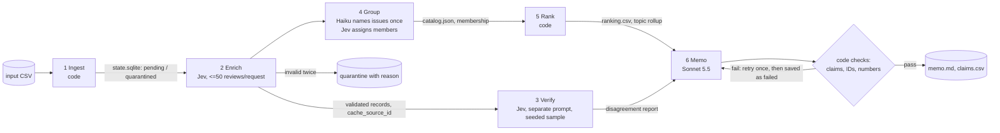

# Spotify review pipeline: multi-agent large-data analysis

Fundamentals of Agentic AI, final assignment. The question: where should Spotify put the next quarter of
product effort (access, usability, playback, or billing/support)? The answer is built from 660,622 real Google
Play reviews (May 2022 to Nov 2023) by a code-controlled pipeline whose every claim can be traced back to
source review IDs.

> **Status (2026-10-02): development checkpoint.** The pipeline runs end to end on the 100- and 500-review
> development files. The full-corpus run, final memo and `grading/` export are **not done yet**. Items marked
> *pending* will be filled from the final run. Current evidence: [CHECKPOINT.md](CHECKPOINT.md).

## Results summary

| | Value | Measured / estimated |
|---|---|---|
| Source rows ingested and profiled | 660,622 (13 empty texts, 159,701 missing app versions, 0 duplicate IDs) | measured ([grading/ingestion.json](grading/ingestion.json), produced by the course helper) |
| Distinct nonempty texts | 484,189 | measured |
| Completed / quarantined classifications (full run) | *pending* | |
| Golden-50 agreement (enrich config) | topic 78%, intent 88%, severity exact 78% (MAE 0.28), sentiment ±0.5 94% | measured ([details](evals/results/golden_probe_golden_shared.md)) |
| Verifier disagreement (500 run, 20-review sample) | 25% any field; planted errors caught 10/10 | measured |
| 100-review pilot | cold $0.0174 / 29.9 s; warm $0 / 0.14 s / 0 calls | measured ([cost/report.md](cost/report.md)) |
| Full-run cost and time | base $7.56, conservative $9.41; about 0.7-1.1 h at 1 worker | **estimate** (refreshed from the 500 run) |

## Rubric → evidence

| Rubric item | Evidence |
|---|---|
| **Deliverable quality (4)** | |
| Accessible code/setup and artifacts | [Setup](#setup), [Commands](#commands); saved outputs under `cost/`, `evals/`, `grading/` |
| Clear architecture, shared schema, provenance | [Architecture](#architecture); schema checks in [pipeline/schema.py](pipeline/schema.py); `label_config` on every record; run manifests with code version |
| Memo numbers linked to calculations and evidence | memo claims in `claims.csv` checked by code against the saved ranking ([pipeline/memo.py](pipeline/memo.py)); *final memo pending* |
| Coherent recommendation, alternatives, limitations | *final memo pending*; 500-review draft: `runs/checkpoint_500/memo/memo.md` |
| **Testing & evaluation (3)** | |
| 50 human labels, per-field comparison, error analysis | [evals/golden_50_labeled.csv](evals/golden_50_labeled.csv), [evals/eval_golden.py](evals/eval_golden.py), [results](evals/results/) |
| Independent verification, planted-error and injection tests | [pipeline/verify.py](pipeline/verify.py), [CHECKPOINT.md](CHECKPOINT.md#independent-verification-and-inspected-failures); injection case in [evals/synthetic/synthetic_8.csv](evals/synthetic/synthetic_8.csv) (*real-model result pending*) |
| Real cold/warm pilot, offline calculator, retry/spend/recovery controls | [cost/report.md](cost/report.md), `python -m cost.calculator`, [evals/results/test_controls.json](evals/results/test_controls.json) |
| **Working result (3)** | |
| Full ingestion, coverage, successful classification | [grading/ingestion.json](grading/ingestion.json); *full-run coverage pending* |
| Staged program, bounded calls, saved handoffs, resume | [pipeline/run.py](pipeline/run.py); *interruption/resume recording pending* |
| Reproducible ranking and grounded final output | `python -m pipeline.rank <run>` (no model calls); *final pending* |

## Architecture



| Stage | Owner | Input → output | Failure behaviour | Why a model / why code |
|---|---|---|---|---|
| Ingest | code | CSV → `state.sqlite`, ingestion report, pending IDs | malformed CSV stops the run | counting, hashing and dedup need no model |
| Enrich | Jev `jev-1.13.0` | distinct pending texts → topic, intent, severity, sentiment | retry once, then quarantine; bounded backoff; budget stop | reading customer language is the judgment; quote, entities, consistency rules and validation are code |
| Verify | Jev, `verify_v1` wording | seeded 2% sample (min 20), text only → independent labels | missing answers reported | an independent second reading; code compares |
| Group | Haiku `claude-haiku-4-5` once; Jev for assignment | bounded complaint examples → issue catalog; complaints → one issue each | invalid IDs dropped; catch-all per topic added by code; unassigned → catch-all (recorded) | naming recurring problems is language work; coverage is guaranteed by code |
| Rank | code | membership + records → `ranking.csv` | none (deterministic) | arithmetic belongs in code |
| Memo | Sonnet 5.5 `claude-sonnet-5-5` | ranking, topic rollup, totals, small evidence pack → memo + claims | code checks; one retry; else saved as failed | the argument needs judgment; numbers are inserted by code |

Who chooses the next step and when the run stops: [CHECKPOINT.md](CHECKPOINT.md#who-chooses-the-next-step-and-when-the-run-stops).

## Setup

Requires Python 3.10+ (developed on 3.12, Windows).

```bash
python -m venv .venv
.venv\Scripts\python -m pip install -r requirements.txt
copy .env.example .env    # then add TYPESAFE_API_KEY and ANTHROPIC_API_KEY (names only are committed)
```

Data: download the course dataset ZIP (Google Drive link in the assignment brief; use Drive's Download button)
and unzip all eleven files into `data/`. The raw CSV is not committed. Expected SHA-256 of
`spotify_reviews_18months.csv`: `1fc85de68a304dd8978b537cfa58793d5f41cbaf417fa32cb53899f83a2fcef6`.
Source: BwandoWando, *3.4 Million Spotify Google Store Reviews*, v2, Kaggle (CC0). See [data/README.md](data/README.md).

## Commands

No API key needed:

```bash
.venv\Scripts\python -m cost.calculator                       # offline cost/runtime replay -> cost/report.md
.venv\Scripts\python -m pipeline.rank runs/<run>              # regenerate ranking from saved outputs
.venv\Scripts\python -m evals.eval_golden runs/probe_golden_shared
.venv\Scripts\python -m evals.test_controls                   # retry / quarantine / resume / budget tests (fake model)
.venv\Scripts\python -m pipeline.run data/cost_100.csv --run _demo --fake   # whole pipeline with fake models
```

Paid (explicit):

```bash
.venv\Scripts\python -m cost.calculator pilot --confirm-paid  # real cold + warm 100-review pilot
.venv\Scripts\python -m pipeline.run data/checkpoint_500.csv --run checkpoint_500
```

## Design choices

- **Two question designs were compared** on cost_100 and the golden 50: `shared_v1` (definitions sent once per
  request) used 305 input tokens/review vs 719 for `inline_v1`, with equal topic/intent agreement. Chosen: `shared_v1`.
- **Exact-text reuse** cuts first-pass work from 660,609 to 484,189 texts; required to stay within budget.
- **Memo numbers are inserted by code**, not typed by the model, after early memos rounded values.
- **No stronger-model fallback** for enrichment: invalid output is retried once, then quarantined.

## Limitations

Self-selected public reviews from a historical window; no revenue, plan tier or observed churn. Cancellation
language is stated intent. Labels are model judgments with measured, imperfect agreement (see above). The
issue catalog's boundaries are reviewed by a person. *Full-run limitations pending.*
